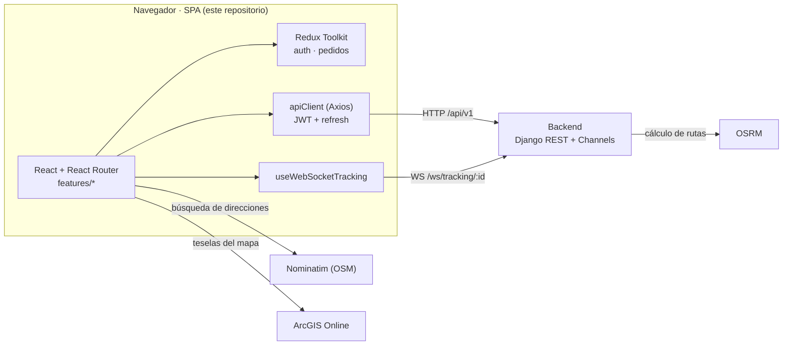
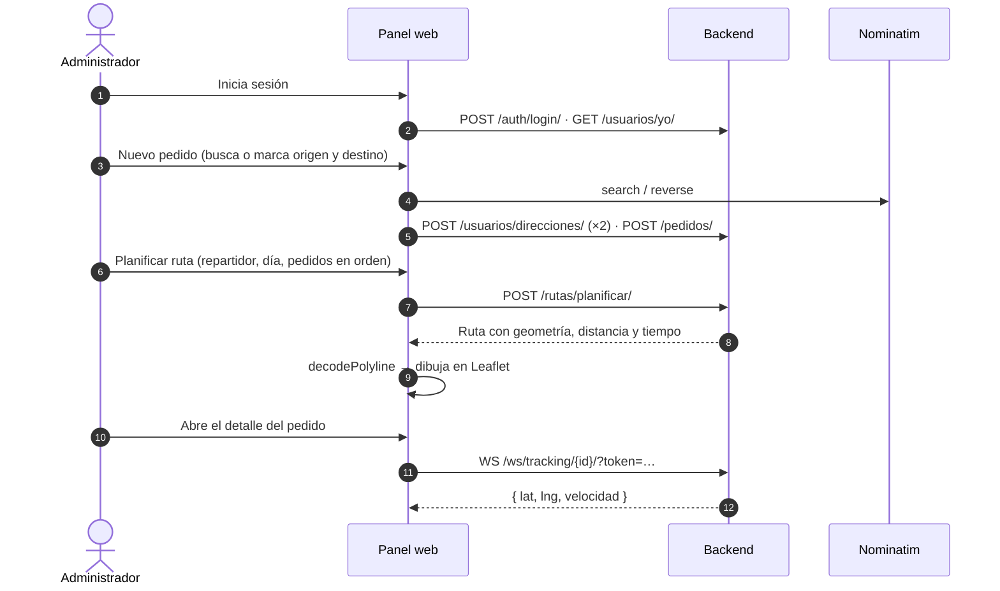

# Logística · Panel de Administración

Aplicación web (SPA) para que un administrador gestione una operación de reparto: registre pedidos, los asigne a repartidores, planifique rutas sobre un mapa, siga cada entrega en tiempo real y consulte el rendimiento del equipo.


Este repositorio es el **panel web** del sistema *Logística y Envíos*. Consume la API REST y el canal WebSocket del backend (`backend_logistica`); los repartidores y clientes usan una app móvil aparte (`movil_logistica`).

<!-- PENDIENTE: enlazar los repositorios del backend y de la app móvil cuando estén publicados. -->
<!-- PENDIENTE: añadir capturas de pantalla o un GIF/demo (por ejemplo en docs/) cuando estén disponibles. -->

---

## Tabla de contenidos

- [Qué resuelve](#qué-resuelve)
- [Características](#características)
- [Stack tecnológico](#stack-tecnológico)
- [Arquitectura](#arquitectura)
- [Flujo de funcionamiento](#flujo-de-funcionamiento)
- [Requisitos previos](#requisitos-previos)
- [Instalación y configuración local](#instalación-y-configuración-local)
- [Variables de entorno](#variables-de-entorno)
- [Ejecución](#ejecución)
- [Rutas de la aplicación](#rutas-de-la-aplicación)
- [API consumida](#api-consumida)
- [Estructura del proyecto](#estructura-del-proyecto)
- [Decisiones técnicas](#decisiones-técnicas)
- [Pruebas y verificación](#pruebas-y-verificación)

---

## Qué resuelve

Una operación de reparto necesita responder tres preguntas: **en qué estado está cada pedido**, **quién lo lleva y por dónde**, y **dónde está ahora**. Este panel reúne esa información en una sola interfaz para el administrador:

| Necesidad | Dónde se resuelve |
|---|---|
| Ver el volumen y el estado de las entregas | Dashboard con indicadores (KPIs) y últimos pedidos |
| Registrar y hacer avanzar pedidos | Formulario de alta, asignación de repartidor y cambios de estado con historial |
| Organizar el reparto de un día | Planificación de rutas con paradas ordenadas y recorrido dibujado en el mapa |
| Saber dónde está un envío | Mapa en tiempo real por WebSocket en el detalle del pedido |
| Evaluar al equipo | Ranking de entregas a tiempo por repartidor |
| Administrar cuentas | CRUD de usuarios de cualquier rol |

---

## Características

**Acceso y sesión**
- Inicio de sesión con **JWT**. Un interceptor de Axios adjunta el token y, ante un `401`, intenta renovarlo con el `refresh` (una vez por petición); si falla, limpia la sesión y redirige a `/login`.
- **Recuperación de contraseña** en dos pasos: correo → código de 6 dígitos + nueva contraseña.
- Rutas privadas y guard de **administrador** (`RutaAdmin`) para la sección de usuarios.

**Dashboard**
- Tarjetas con total de pedidos, entregados, en camino y cancelados.
- Ranking de eficiencia de repartidores y tabla con los últimos pedidos.

**Pedidos**
- Listado con código de seguimiento, cliente, repartidor, estado y fecha.
- **Alta de pedido**: cliente, repartidor opcional, peso, costo y fecha estimada. Origen y destino se eligen **buscando la dirección** (geocodificación con Nominatim) o **marcando el punto en el mapa** (geocodificación inversa).
- **Detalle**: reasignación de repartidor, cambio de estado limitado a las `transiciones_permitidas` que devuelve la API (con comentario opcional), línea de tiempo del historial y mapa de seguimiento en vivo.

**Rutas**
- Planificación: repartidor, día y pedidos marcados **en el orden de visita**. El formulario exige al menos 2 pedidos con destinos distintos, excluye pedidos en estado final y bloquea los que ya van en otra ruta planificada o en curso.
- Visualización: distancia y tiempo estimados, recorrido (polyline) y marcadores numerados por parada, coloreados según su estado (pendiente, entregada, fallida).

**Reportes**
- Ranking de repartidores por **porcentaje de entregas a tiempo**, con indicador de severidad (≥ 90 %, ≥ 70 %, menor), calificación promedio y tiempo medio.

**Usuarios** (solo administradores)
- Alta, edición y baja de cuentas de cualquier rol; búsqueda con *debounce*, filtros por rol y estado, paginación y diálogo de confirmación.
- "Eliminar" puede **eliminar o desactivar** (si la persona tiene historial); la interfaz distingue ambos casos por el campo `resultado` de la respuesta.
- En edición, la contraseña es opcional: en blanco no se modifica.

**Experiencia de uso**
- Estados de carga, vacío y error con botón de reintento en las pantallas de datos.
- Diseño adaptable: el menú lateral pasa a cajón en pantallas pequeñas (puntos de corte en 768 px y 1024 px).
- Accesibilidad: diálogo modal con foco atrapado y cierre con `Esc`, etiquetas `aria-*` y respeto a `prefers-reduced-motion`.

---

## Stack tecnológico

| Capa | Tecnología | Versión declarada | Uso |
|---|---|---|---|
| UI | React | ^18.3.1 | Componentes y hooks |
| Lenguaje | TypeScript | ^5.4.5 | Modo estricto (`strict`, `noUnusedLocals`, `noUnusedParameters`) |
| Build y dev server | Vite + `@vitejs/plugin-react` | ^5.3.1 · ^4.3.1 | Servidor de desarrollo y empaquetado |
| Estado global | Redux Toolkit + react-redux | ^2.2.5 · ^9.1.2 | Slices `auth` y `pedidos`; el resto de pantallas usa estado local |
| Enrutado | react-router-dom | ^6.23.1 | `BrowserRouter`, rutas anidadas y guards |
| HTTP | axios | ^1.7.2 | Cliente de API con interceptores JWT |
| Mapas | leaflet + react-leaflet | ^1.9.4 · ^4.2.1 | Rutas, selección de ubicación y tracking |
| Estilos | CSS propio | — | Tokens de diseño (`tokens.css`), base y componentes; sin framework de UI ni de formularios |

**Servicios externos que el navegador consulta directamente**

| Servicio | Para qué |
|---|---|
| Nominatim (OpenStreetMap) | Búsqueda de direcciones y geocodificación inversa (restringida a Perú: `countrycodes=pe`) |
| ArcGIS Online — *World Light Gray Canvas* | Teselas del mapa base (atribución: Esri, HERE, Garmin y colaboradores de OpenStreetMap) |

No se utiliza ninguna API key en el cliente.

---

## Arquitectura



- El código se organiza **por *features*** (`auth`, `pedidos`, `rutas`, `tracking`, `reportes`, `dashboard`, `usuarios`); cada una agrupa sus componentes, su cliente de API y, cuando aplica, su *slice*.
- **El backend calcula las rutas**: llama a OSRM y guarda la geometría codificada. El panel solo la decodifica (`utils/polyline.ts`) y la dibuja con Leaflet.
- El seguimiento en vivo llega por **WebSocket**; el token JWT viaja en la *query string* porque el navegador no permite cabeceras propias en el *handshake*.

---

## Flujo de funcionamiento



> El punto que se ve en el mapa lo emite la **app móvil** del repartidor. Sin esa app (o un emulador con ubicación simulada) el panel muestra «Esperando a que el repartidor active "En servicio"».

---

## Requisitos previos

| Requisito | Detalle |
|---|---|
| Node.js | `^18` o `>=20` (requisito de Vite 5). Verificado con Node.js 24 y npm 11 |
| npm | Incluido con Node.js. El repositorio trae `package-lock.json` |
| Backend en ejecución | `backend_logistica` accesible en `http://localhost:8000` (ver más abajo) |
| Acceso a internet | Para las teselas del mapa y la búsqueda de direcciones |

---

## Instalación y configuración local

**1. Levantar el backend**

El panel no funciona sin la API. Sigue el `README.md` de `backend_logistica` para configurar PostgreSQL y su `.env`; después, desde esa carpeta y con su entorno virtual activo:

```bash
python manage.py migrate
python manage.py seed_demo
daphne -b 127.0.0.1 -p 8000 config.asgi:application
```

Se usa Daphne (ASGI) porque el seguimiento en tiempo real requiere WebSockets.

**2. Clonar e instalar el panel**

```bash
git clone <URL-DEL-REPOSITORIO>
cd frontend_logistica
npm install
```

**3. Configurar las variables de entorno (opcional en local)**

```powershell
# Windows (PowerShell)
Copy-Item .env.example .env
```

```bash
# macOS / Linux
cp .env.example .env
```

Si el backend corre en `localhost:8000`, los valores por defecto ya funcionan (ver [Variables de entorno](#variables-de-entorno)).

---

## Variables de entorno

Vite solo expone al cliente las variables con prefijo `VITE_`, y **sus valores quedan incrustados en el bundle**: no guardes secretos en ellas. El archivo `.env` está en `.gitignore`; el repositorio incluye `.env.example`.

| Variable | Obligatoria | Valor por defecto | Descripción |
|---|:---:|---|---|
| `VITE_API_URL` | No | `http://localhost:8000/api/v1` | URL base de la API REST |
| `VITE_WS_URL` | No | `ws://localhost:8000` | Origen del servidor WebSocket (sin ruta; el panel añade `/ws/tracking/<id>/`) |

Ambas tienen el mismo valor por defecto dentro del código, así que el `.env` solo es necesario si el backend vive en otra dirección. Al cambiarlas hay que reiniciar `npm run dev` (o volver a ejecutar `npm run build`).

---

## Ejecución

```bash
npm run dev
```

La aplicación queda en **http://localhost:5173**.

### Acceso de demostración

`seed_demo` (backend) crea una cuenta de administrador de demostración:

| Rol | Correo | Contraseña |
|---|---|---|
| Administrador | `admin@logistica.com` | `admin1234` |

> ⚠️ Son credenciales públicas de demostración definidas en el backend. No ejecutes `seed_demo` en un entorno accesible desde internet.

### Scripts disponibles

| Comando | Descripción |
|---|---|
| `npm run dev` | Servidor de desarrollo con recarga en caliente (puerto 5173) |
| `npm run build` | Comprobación de tipos (`tsc -b`) y build de producción en `dist/` |
| `npm run preview` | Sirve localmente el build generado |

> `package.json` también declara `npm run lint`, pero ESLint no figura entre las dependencias ni hay archivo de configuración, por lo que ese script no es ejecutable por ahora.

### Recuperar contraseña en desarrollo

`/recuperar` envía un código de 6 dígitos por correo. En desarrollo, sin credenciales SMTP en el backend, **el correo se imprime en el terminal donde corre Daphne**: de ahí se copia el código.

---

## Rutas de la aplicación

| Ruta | Acceso | Pantalla |
|---|---|---|
| `/login` | Pública | Inicio de sesión |
| `/recuperar` | Pública | Recuperación de contraseña (2 pasos) |
| `/` | Autenticado | Dashboard |
| `/pedidos` | Autenticado | Listado de pedidos |
| `/pedidos/nuevo` | Autenticado | Alta de pedido |
| `/pedidos/:id` | Autenticado | Detalle, cambio de estado y seguimiento en vivo |
| `/rutas` | Autenticado | Rutas planificadas y mapa |
| `/rutas/nueva` | Autenticado | Planificar ruta |
| `/reportes` | Autenticado | Eficiencia de repartidores |
| `/usuarios` | Administrador | Listado y filtros de usuarios |
| `/usuarios/nuevo` · `/usuarios/:id` | Administrador | Alta y edición de usuario |

Cualquier otra ruta redirige a `/`. La autorización real la impone el backend; los guards del cliente solo evitan mostrar pantallas que fallarían.

---

## API consumida

Rutas relativas a `VITE_API_URL` (por defecto `http://localhost:8000/api/v1`). Los contratos los define el backend, cuya documentación interactiva (Swagger) está en `http://localhost:8000/api/docs/`.

| Método | Ruta | Uso en el panel |
|---|---|---|
| POST | `/auth/login/` | Obtener `access` y `refresh` |
| POST | `/auth/refresh/` | Renovar el token desde el interceptor |
| POST | `/auth/password-reset/` | Solicitar el código de recuperación |
| POST | `/auth/password-reset/confirmar/` | Canjear el código y fijar la nueva contraseña |
| GET | `/usuarios/yo/` | Usuario autenticado |
| GET · POST | `/usuarios/` | Listado con filtros (`search`, `rol`, `activo`, `page`) · alta |
| GET · PATCH · DELETE | `/usuarios/{id}/` | Detalle · edición · baja o desactivación |
| GET | `/usuarios/repartidores/` | Selectores de repartidor |
| GET · POST | `/usuarios/direcciones/` | Listar (filtro `usuario`) · crear direcciones de un pedido |
| GET · POST | `/pedidos/` | Listado (`page`, `page_size`) · alta |
| GET · PATCH | `/pedidos/{id}/` | Detalle · asignar repartidor |
| POST | `/pedidos/{id}/cambiar-estado/` | Cuerpo `{ codigo, comentario }` |
| GET | `/pedidos/estados/` | Catálogo de estados *(cliente definido, sin uso actual en pantallas)* |
| GET | `/rutas/` | Listado de rutas con sus paradas |
| POST | `/rutas/planificar/` | Cuerpo `{ repartidor, fecha, pedidos[] }` |
| GET | `/reportes/resumen/` | KPIs del dashboard |
| GET | `/reportes/rendimiento-repartidores/` | Ranking de eficiencia |

**WebSocket**

```
ws://localhost:8000/ws/tracking/<pedido_id>/?token=<access_jwt>
```

El hook `useWebSocketTracking` recibe mensajes `{ lat, lng, velocidad? }` y traduce los códigos de cierre `4401` (sesión expirada), `4403` (sin permiso), `4404` (pedido inexistente) y `4503` (servidor de tiempo real no disponible) en mensajes para el usuario.

---

## Estructura del proyecto

```
frontend_logistica/
├── index.html
├── package.json
├── vite.config.ts            # plugin de React y puerto 5173
├── tsconfig.json
├── .env.example              # VITE_API_URL, VITE_WS_URL
└── src/
    ├── main.tsx              # Provider de Redux, BrowserRouter y estilos de Leaflet
    ├── app/                  # App, routes (guards), store y hooks tipados
    ├── features/
    │   ├── auth/             # login, recuperar contraseña, authSlice, authApi
    │   ├── dashboard/        # AdminDashboard con KPIs
    │   ├── pedidos/          # tabla, detalle, formulario, pedidosSlice, pedidosApi
    │   ├── rutas/            # listado, planificación, MapaRuta, TiraRecorrido, rutasApi
    │   ├── tracking/         # MapaTiempoReal y hook useWebSocketTracking
    │   ├── reportes/         # GraficoEficiencia (ranking) y reportesApi
    │   └── usuarios/         # CRUD, selectores de dirección/ubicación y usuariosApi
    ├── components/           # UI compartida: ui.tsx (Card, Boton, Campo…), Tabla, Kpi,
    │                         # Paginacion, Estados, DialogoConfirmacion, CapaBase, Iconos,
    │                         # CiudadReparto (ilustración SVG de la pantalla de acceso)
    ├── layouts/              # AdminLayout (menú lateral / cajón móvil)
    ├── services/             # apiClient (Axios + JWT) y geocoding (Nominatim)
    ├── styles/               # tokens.css, base.css, componentes.css
    ├── types/                # Tipos del dominio (Usuario, Pedido, Ruta…)
    └── utils/                # decodePolyline, mensajeDeError
```

---

## Decisiones técnicas

- **Sin librería de formularios ni de UI**: el kit propio de `components/ui.tsx` y los tokens CSS bastan para el alcance del panel. Los diálogos de confirmación usan un componente accesible propio (`DialogoConfirmacion`).
- **Mapas con Leaflet sin API key**: teselas públicas de ArcGIS y Nominatim para direcciones, en lugar de Google Maps.
- **La geometría de la ruta llega ya calculada**: el backend la guarda y el cliente solo la decodifica, de modo que web y móvil dibujan el mismo recorrido.
- **La API decide las transiciones de estado**: el panel solo ofrece las que vienen en `transiciones_permitidas`, sin duplicar la máquina de estados.
- **Baja de usuarios con historial**: como `Pedido.cliente` está protegido en el backend, eliminar a alguien con pedidos lo desactiva. Ambos casos responden `200`, por lo que la interfaz lee `resultado` (`eliminado` / `desactivado`) y no el código HTTP.
- **Sin autoeliminación**: el botón "Eliminar" no se ofrece sobre la propia cuenta.
- **Alias de importación**: `tsconfig.json` declara `@/*`, pero `vite.config.ts` **no** lo resuelve. Usa rutas relativas, como el resto del código; con `@/…` compilaría en el editor y fallaría en ejecución.
- **Ranking propio en lugar de gráfica**: el informe de eficiencia se dibuja con marcado y CSS propios. `recharts` figura en `dependencies`, pero ningún módulo la importa.

---

## Pruebas y verificación

No hay pruebas automatizadas (ni unitarias ni de integración) ni integración continua configuradas.

La verificación disponible es la del compilador: `npm run build` ejecuta `tsc -b` con TypeScript en modo estricto y luego `vite build`. Al documentar el proyecto se ejecutaron con éxito `tsc --noEmit` y `vite build` sobre el estado actual del código.

---

